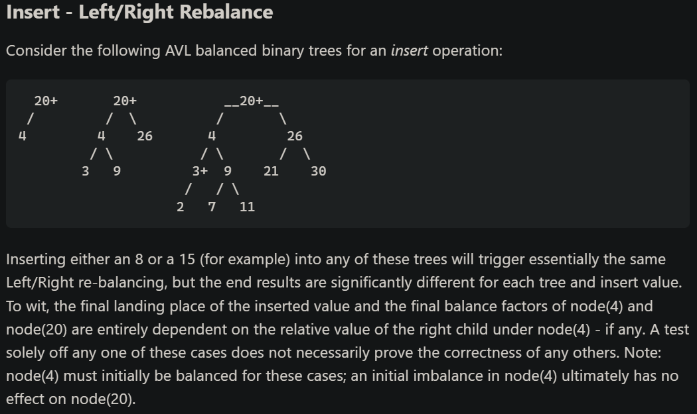
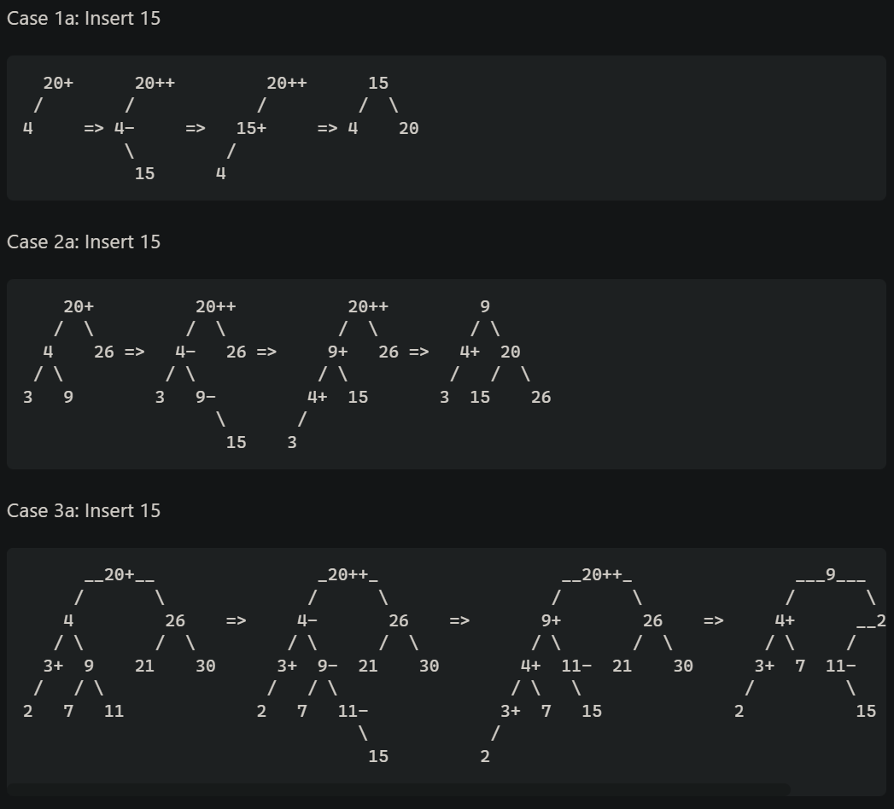
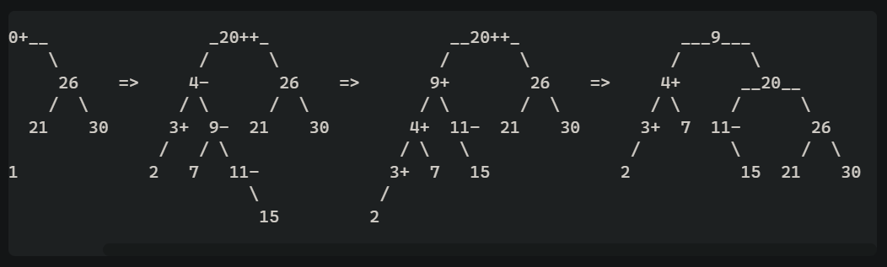
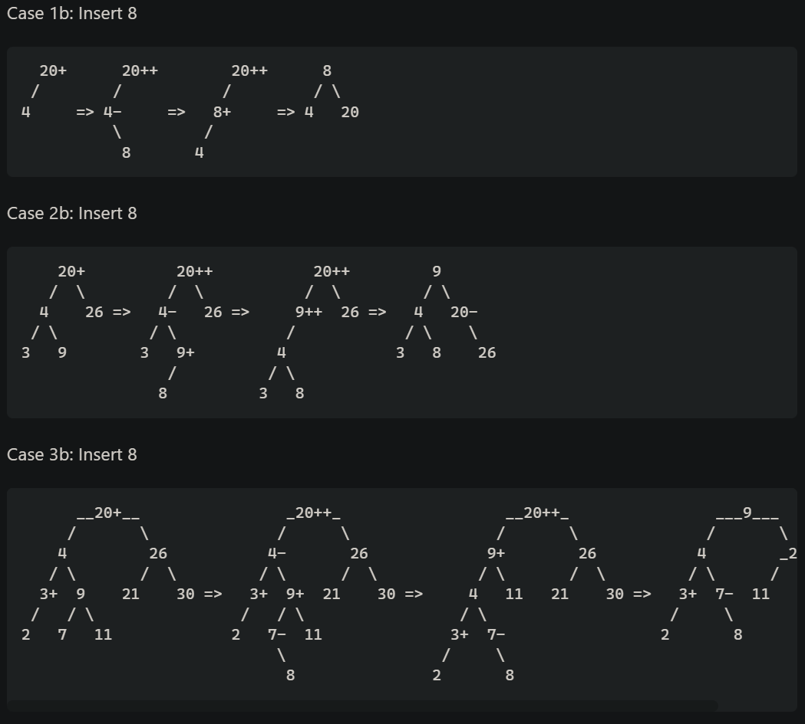
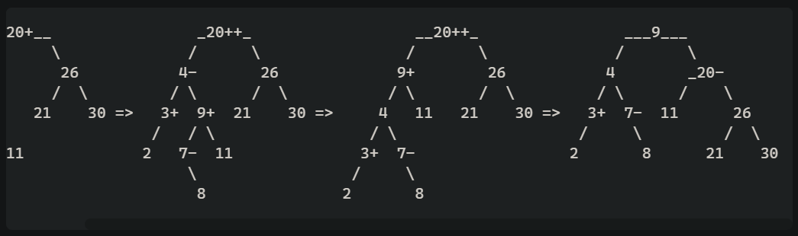
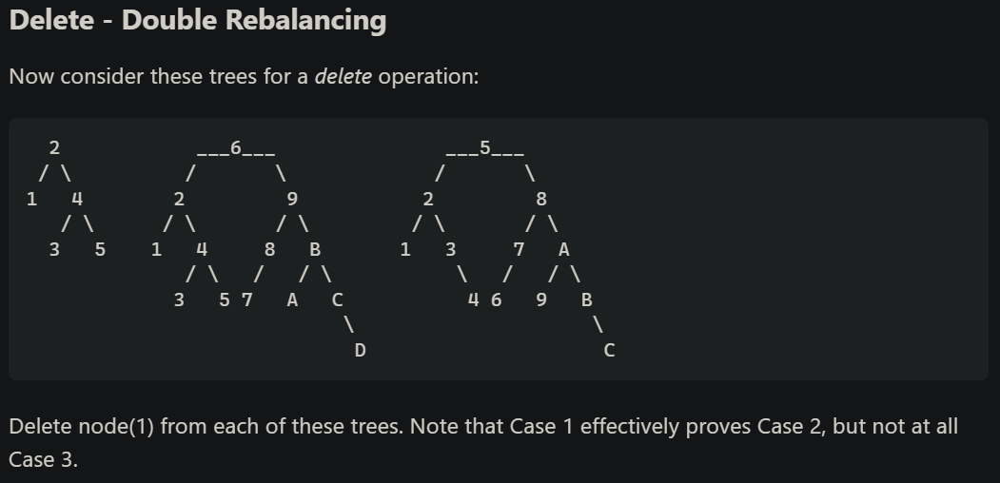
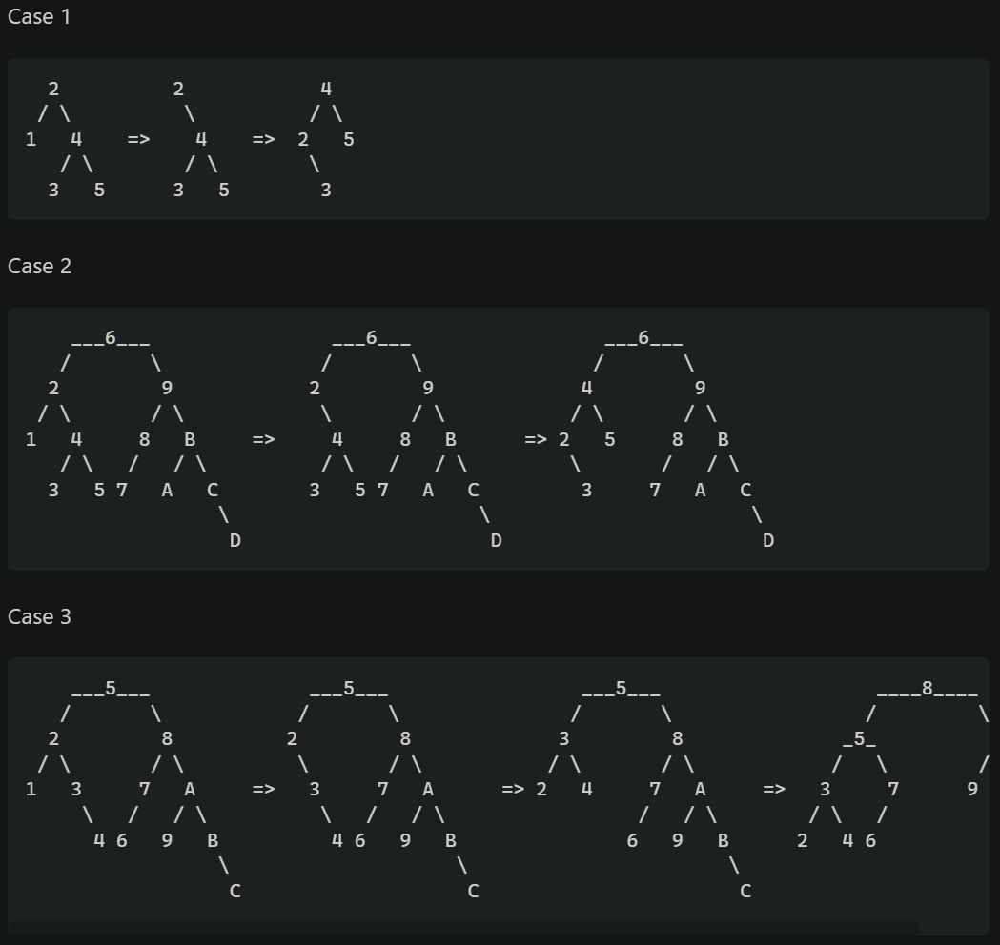
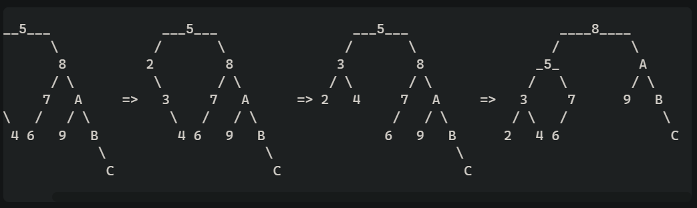

# AVL Tree Explorer

An interactive C# console application for exploring AVL trees.
Enter integers, add and remove nodes, search for values, and inspect the tree in two terminal views.
The menu and console messages are in German.

This is a learning project with a generic tree implementation and a console interface built around integer values.

## Features

- Create a tree from manually entered integers or 3 to 42 randomly generated values.
- Add, search for, check, and remove values through a numbered menu.
- Display a node count and a calculated tree height.
- Draw the tree using ASCII branches, optionally with balance indicators.
- Show an alternative view with box-drawing characters and highlighted nodes.
- Inspect the implementation of single and double AVL rotations.

## Run

The project targets .NET 6 and has no external NuGet package dependencies.
Use an SDK that can build `net6.0` and a .NET 6 runtime to run it.

```sh
git clone https://github.com/goldbarth/avl-tree-explorer.git
cd avl-tree-explorer
dotnet run --project DataStructure/AvlTree/AvlTree.csproj
```

Run it in an interactive terminal with cursor positioning and Unicode support.
The application uses `Console.ReadKey`, clears the screen, and places tree nodes at specific cursor positions.

To build the solution separately:

```sh
dotnet build DataStructure/AvlTree.sln
```

## Usage

1. Press a key to continue past the introduction.
2. Choose manual input or random values.
3. For manual input, enter integers separated by spaces, commas, periods, semicolons, or colons, for example `30 20 10`.
4. Choose whether to show balance indicators in the initial tree view.
5. Use the menu to modify or inspect the tree.

Menu selections use the number keys on the main keyboard, followed by another key press, such as Enter.
The add, search, and delete prompts accept values from 1 to 100.
Initial manual input is parsed directly as integers without that range restriction.

| Key | Action |
| --- | --- |
| `1` | Add a node |
| `2` | Search for a value and print the result |
| `3` | Check whether a value exists |
| `4` | Remove a node |
| `5` | Print the calculated tree height |
| `6` | Print the node count |
| `7` | Redraw the ASCII tree and choose balance indicators |
| `8` | Draw the box-character view |
| `9` | Exit |

## Implementation

| File | Purpose |
| --- | --- |
| `DataStructure/AvlTree/Program.cs` | Application entry point |
| `DataStructure/AvlTree/Application.cs` | German menus, integer input, and console interaction |
| `DataStructure/AvlTree/AvlTree.cs` | Generic `AvlTree<T>`, insertion, lookup, removal, and rotations |
| `DataStructure/AvlTree/Node.cs` | Node values, child references, height, and balance metadata |
| `DataStructure/AvlTree/TreePrinter.cs` | Both terminal renderers |
| `DataStructure/AvlTree/NodeInfo.cs` | Layout information used by the renderers |

`AvlTree<T>` uses `Comparer<T>.Default` to order values.
There is no public API for supplying a custom comparison delegate.
Several public methods print directly to the console, including `Contains`, `GetCount`, and `GetMaxDepth`.
The solution contains one executable project; it does not include a separate class library or a second project demonstrating DLL consumption.

## Current limitations

The implementation is useful for studying the code and experimenting with tree operations, but it has known correctness and input-handling limitations:

- Equal values are not inserted as additional nodes, but each `Add` call increments the displayed count.
- Removing a missing value still decrements the count and prints a success message.
- Tree height calculation and height maintenance during deletion need correction; do not rely on reported heights or AVL invariants after arbitrary deletions.
- `GetNode` returns a new node containing the matching value rather than the stored node with its children and metadata.
- Invalid initial manual input can terminate the application.
- There is no automated test project in the repository.

## Reference images and sources

These tree-operation reference images are retained from the original README.
They are not an automated test suite.

<details>
<summary>View the existing tree-operation images</summary>










</details>

- [AVL correctness checks and test cases](https://stackoverflow.com/questions/3955680/how-to-check-if-my-avl-tree-implementation-is-correct), linked in the original README.
- [Printing a binary search tree in a C# console](https://stackoverflow.com/questions/36311991/c-sharp-display-a-binary-search-tree-in-console), credited in `TreePrinter.cs`.
- [Programiz: AVL tree](https://www.programiz.com/dsa/avl-tree), linked in `Program.cs`.
- [University of San Francisco: AVL tree visualization](https://www.cs.usfca.edu/~galles/visualization/AVLtree.html), linked in `Program.cs`.
